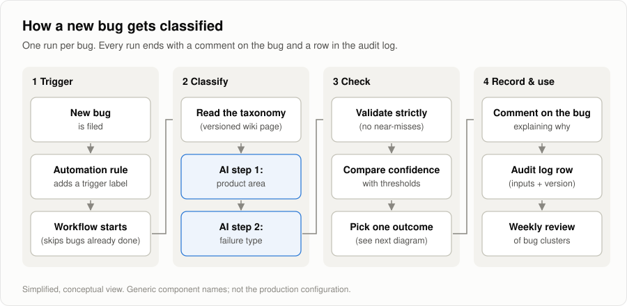
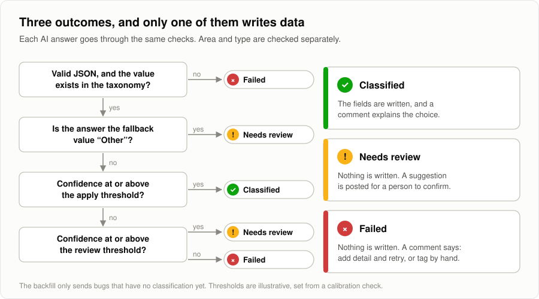
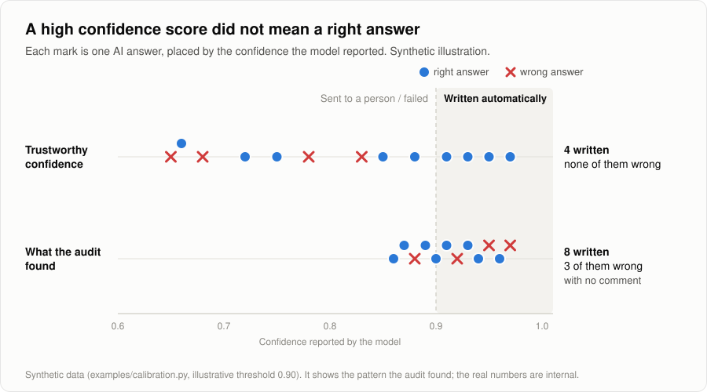

# AI Bug Classification Pipeline

*Jira · n8n · LLM API · Confluence. Designed April–May 2026 and built May–June 2026 at a B2B SaaS
company; in production since July 2026.*

## At a glance

| | |
|---|---|
| **Problem** | Leads wanted to know where bugs cluster, but bug tagging was manual, patchy and inconsistent between teams. |
| **What I built** | A pipeline that classifies every new bug by product area and failure type with an LLM, checks each answer against a versioned taxonomy, and writes only the answers it is confident about. |
| **Leverage** | Consistent bug-pattern data that the product group reviews every week. People only look at the cases the system is unsure about. |
| **My role** | Designed and built it end to end, then audited it after rollout and fixed what the audit found. |
| **Key lesson** | The model's confidence turned out not to predict accuracy, so a threshold alone was not a safeguard (chart below). |



## Problem

Engineering leads wanted to know where bugs cluster, so they could argue for planning work with
data rather than anecdotes. The raw material was there, but tagging was manual and inconsistent.
Many bugs had no type at all, and the ones that did used the categories differently from team to
team. Manual tagging had produced that data in the first place, so more of it wasn't the answer.

The goal was **pattern detection for quality reviews and planning**. It was not routing or
assignment. That distinction shaped several decisions below: a missing classification costs little,
but a confidently wrong one quietly pollutes the trend data.

## My contribution

- Researched the options and chose the architecture (event-triggered workflow engine + LLM API +
  issue-tracker write-back), including the taxonomy-source strategy, the confidence/review flow and
  the logging requirements.
- Built the n8n workflow end to end: payload normalisation, taxonomy retrieval, both LLM stages,
  output validation, the decision logic, Jira updates, explanatory comments and the audit log.
- Added the trigger route in the company's event-relay service so that a Jira label reaches the
  workflow.
- Built the two Jira Automation rules: one adds the trigger label to new bugs, the other keeps
  outcome labels in sync after manual edits.
- Wrote the per-team taxonomy definitions for Problem Area and Problem Type.
- Built the reporting dashboard, and wrote the operating guide used when the team handed the
  system over.
- Ran the post-rollout audit, traced the failure modes to their root causes, and shipped the fixes.

I built the system end to end. The product team that uses it reviewed the taxonomy and its
definitions for correctness.

## How it decides what to write

Every AI answer passes the same checks, and only one of the three outcomes changes the bug's fields.
The others leave the data alone and explain themselves in a comment.



More detail, including the run sequence and the eligibility rules, is in
[architecture.md](architecture.md).

## Key engineering decisions

**The taxonomy lives in a wiki page, not in the prompt.** Product areas change whenever teams
reorganise. The workflow reads the current definitions on every run and records which version it
used. Changing a category means editing a document, not redeploying a workflow, and every
historical decision can be traced back to the taxonomy that produced it.

**Two stages, gated independently: Area first, then Type.** Area was the original scope. Type was
added as a second stage once the Area path had proved itself. Each stage has its own validation,
its own confidence and its own write decision, so a good Area answer is kept even when the Type
answer is invalid or uncertain. That case gets its own explanatory comment instead of the whole
classification failing. A single combined score would have hidden which half was weak.

**Validate strictly and never repair.** Every response has to parse as JSON, contain the expected
keys, use a value that exists in the current taxonomy, and give a numeric confidence. A near-miss
value such as "Data Loss" when the list says "Data Integrity" is rejected, not fuzzy-matched.
A pipeline that silently corrects the model hides how often the model is wrong.

**Three explicit outcomes.** *Classified*, *Needs review* and *Failed*, each with its own label, so
the review queue is a simple filter rather than a dashboard query. The fallback values ("Other") are
never auto-applied, whatever confidence the model reports.

**Driven by labels, not by "issue created" events.** Adding the label starts a run, and removing it
marks the run done. New bugs and manual retries ("improve the description, re-add the label") share
one entry point. A separate backfill job sends older bugs to the same workflow in controlled
batches, so all the classification logic lives in one place.

## Reliability and safeguards

- **Idempotency.** A bug that is already fully classified is skipped. The backfill only selects bugs
  with *neither* field set, so existing values are never re-decided (see lessons below).
- **Snapshot before bulk changes.** Before the backfill I exported the original values, so every
  change it made could be compared and reverted.
- **Write gate.** Only the *Classified* outcome writes the fields. *Needs review* posts a suggestion
  without changing them, so a tentative answer never shows up in the data as if it were final.
- **Every write is explained.** Each outcome, including confident auto-applies, adds a comment with
  the chosen values, the confidence and the model's reasoning. Reviewers see why, not just what.
- **Fail closed.** Invalid or unusable output ends in *Failed*, with an explanation and a suggested
  next step (add detail and retry, or classify by hand).
- **Audit log.** One row per run: issue, outcome, confidence, taxonomy version, label changes.
  That table is what made the post-rollout audit possible.
- **Runbook.** The operating guide covers each symptom: label stuck, execution failed, outcome label
  out of sync, taxonomy out of date.

## Impact and leverage

- Every new bug in the project gets a structured classification automatically, with no manual
  tagging step.
- It is built into a weekly routine: the product group's lead reviews the bug-clusters dashboard
  with the team every week. They look for the most common areas and types over 7 and 30 days,
  emerging spikes, and clusters worth investigating or turning into planned work, and they clear
  the low-confidence and failed classifications.
- The review queue is limited to the cases the system is unsure about, so the remaining human work
  is targeted.
- Because every decision is logged with its inputs and taxonomy version, the system can be audited.
  That turned out to be its most important property (next section).

I don't have a before/after measure of triage time, or a count of planning decisions it influenced,
so I don't claim one.

## What the audit taught me

A few weeks after rollout I audited a sample of AI-classified bugs against careful human review.
The system worked mechanically, but it was not always right, and the reasons were worth more than
the fixes.

1. **Self-reported confidence is not calibration.** Wrong answers came with the same high
   confidence as correct ones, so the threshold filtered almost nothing. Worse, explanatory comments
   fired only *below* the threshold, which meant the confidently wrong answers were exactly the
   silent ones. Fix: comment on every write, and raise the write gate so that *Needs review* results
   are no longer stored as final. What I'd do from day one: measure accuracy by confidence band on a
   reviewed sample *before* choosing thresholds (see `examples/calibration.py`).

   

   *Illustration with synthetic data from [`examples/calibration.py`](examples/calibration.py). It
   shows the pattern the audit found, not the production numbers.*

2. **Filling a gap re-decided values that already existed.** So that older bugs would count on
   the dashboard, the backfill also selected bugs that already had an area and type but no
   classification status. The classifier re-classified them rather than only completing the
   status, and changed some existing values. I had exported the original values before the run, so
   I compared them afterwards, checked the conflicting cases with the developers who knew those
   bugs, and reverted where the original was right. Fix: the backfill selects only bugs with
   neither value set. Some of the changed values came from another tool, which made the conflicts
   a taxonomy question as well (lesson 3).

3. **Disagreement came from the taxonomy, not the prompt.** Another tool also wrote these fields,
   and it disagreed with the classifier. Both read the same definitions, and the definitions had
   overlapping categories with no tie-break rules. One definition even contradicted itself: its
   description covered "errors" in general, while its usage guidance said "fails intermittently".
   Tuning prompts can't fix an ambiguous spec, and neither the human nor the AI answer was reliably
   the right one.

   I wrote a revision of the taxonomy, with each change tied to the audit finding it would fix:
   - **A rule for Area:** classify by the component that has to change to fix the bug, not the
     screen where the symptom showed up, and check against the owning team.
   - **A precedence order for Type:** first match wins. The catch-all "functional defect" becomes
     the last resort instead of the default.
   - **Rewritten boundary definitions:** "reliability" means *non-deterministic*. A bug is "data
     integrity" if the user-visible result is wrong data, whatever caused it. Permissions issues
     cover leaks as well as denials.
   - **A structural change:** "regression" answers a different question (*did a change cause
     this?*) from every other type (*what kind of failure is it?*). It should be a separate field,
     not one option in a single-select list.
   - **Fixing gaps and near-duplicates** that forced misclassifications.

   The workflow re-reads the taxonomy on every run, so adopting this needs no code change. It does
   need the teams who own the categories to agree on it. So far it hasn't been adopted. That is the
   real lesson for me: the hard part of an AI classifier is the agreement on what the categories
   mean, and that work has to come before rollout, not after.

4. **One category absorbed most bugs.** "Functional defect" took the large majority of typed bugs,
   so the Type dimension discriminates poorly. Both the precedence rule and splitting "regression"
   into its own field above are aimed at this.

Other trade-offs I accepted: an LLM call per bug costs more than a fine-tuned classifier but needs
no training data and adapts to taxonomy edits immediately. Using a wiki page as the taxonomy source
means a badly formatted edit can break parsing, which is why the runbook lists it as a check.

## Technology stack

n8n (workflow orchestration, data table for the audit log) · Jira Cloud (webhooks, Automation
rules, custom fields, REST API) · Confluence (taxonomy source, read through its API) · a hosted LLM
API returning structured JSON · a small event-relay service · Jira dashboards for reporting.

## See it run

The [`examples/`](examples/) folder has a small, standard-library Python demo of the design: the two
AI steps, strict validation, the three outcomes, safe re-runs and the audit log, using synthetic bugs
and a scripted fake model. It is optional reading for technical reviewers.

```bash
cd examples && python3 pipeline.py --reset && python3 calibration.py
```

## Disclosure note

This write-up and everything in [`examples/`](examples/) were prepared independently for this
portfolio. The diagrams are conceptual. The code is a new, minimal illustration of the design ideas,
using synthetic data, a scripted fake model and illustrative thresholds. It is **not** the
production workflow, its prompts, configuration or data, and it is not derived from them. Company,
product, team and ticket details are deliberately omitted.
