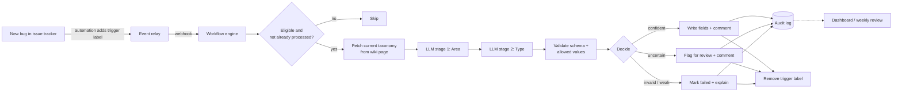
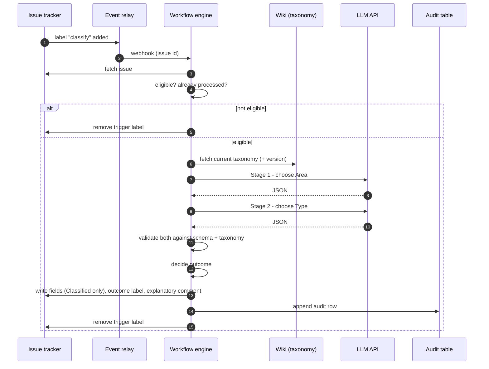
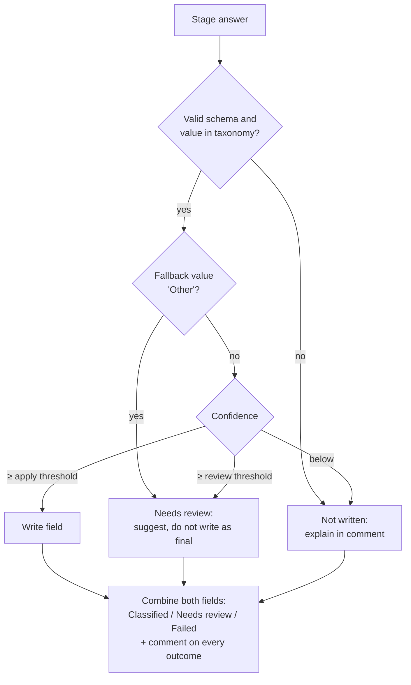
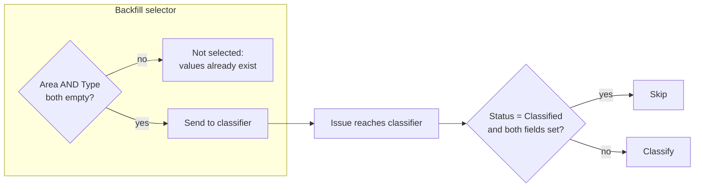

# Architecture: AI Bug Classification Pipeline

Conceptual only. Component names are generic, and internal topology, hosts and identifiers are
intentionally omitted.

## Components

| Component | Responsibility |
|---|---|
| Issue tracker | Source of bugs; holds the Area / Type / Status fields and outcome labels |
| Tracker automation rule | Adds a trigger label to new bugs; a second rule syncs outcome labels after manual edits |
| Event relay | Forwards label events to the workflow engine over an authenticated webhook |
| Workflow engine | Orchestrates the run: eligibility, taxonomy fetch, LLM stages, validation, decision, write-back |
| Wiki page | Human-maintained taxonomy (each value with description, when to use, examples) |
| LLM API | Returns a JSON classification per stage |
| Audit table | One row per run, for monitoring, debugging and later audits |
| Dashboard | Problem Area × Type breakdowns and trends for weekly review |

## Overview flow



## Run sequence



## Decision logic

Each field (Area, Type) passes through this gate on its own, so a valid Area is kept even if the
Type answer is rejected. The overall status reflects the weaker of the two.



Thresholds should come from a calibration check on a human-reviewed sample. Without one they look
like safeguards but filter nothing (see Lessons in the README).

## Eligibility and idempotency



- New bugs and manual retries come in through a label; backfills send older bugs to the same
  workflow, so classification logic exists in exactly one place.
- The backfill selector requires **both** fields to be empty. The first version also selected bugs
  that had values but no status, and the classifier re-decided some of those values. A
  pre-backfill export made every change reviewable; conflicting values were checked and reverted
  where the original was right, and the selector was fixed.
- The illustrative code in `examples/` adds a content-hash idempotency key, so that duplicate webhook
  deliveries are also no-ops. That is an extension for the demo, not a description of production.

## Audit record (illustrative shape)

```json
{
  "issue": "DEMO-104",
  "at": "2026-01-01T09:00:00Z",
  "model": "<model id>",
  "taxonomy_version": "v7",
  "area":  {"value": "Import & Export", "confidence": 0.92, "attempts": 1},
  "type":  {"value": "Data Integrity", "confidence": 0.78, "attempts": 2},
  "outcome": "needs_review",
  "fields_written": {}
}
```

## Failure handling

| Failure | Behaviour |
|---|---|
| Malformed / off-taxonomy LLM output | *Failed* outcome, with an explanation and next steps in a comment |
| Low or mid confidence | *Needs review*: suggestion in a comment, fields not overwritten as final |
| Workflow execution error | Visible as a failed execution in the workflow engine; the runbook covers how to find and retry it |
| Bug already fully classified | Skipped |
| Manual correction after a run | Outcome label re-synced by a tracker rule; AI does not re-run unless the label is re-added |
